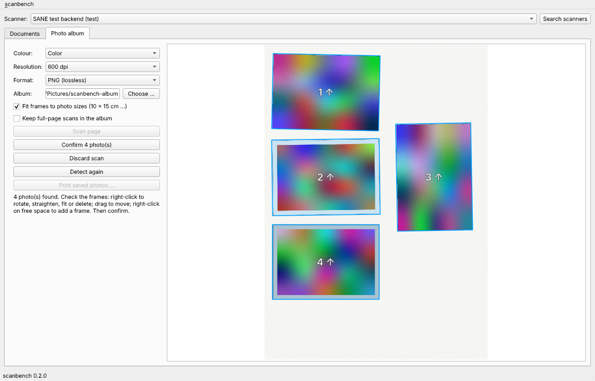

# scanbench

Document and photo-album scanning for Linux, built on SANE.

> **Status: version 0.2.0, first testable draft.** Documents (simplex,
> duplex, PDF in five sizes), photo albums (detection, editing,
> confirmation) and printing through CUPS work; device profiles, the
> calibration wizard and album export follow. See the
> [roadmap](docs/concept/README.md#roadmap).

## What scanbench does

* **Documents:** A4, A5, A6 and Letter from the flatbed or the document
  feeder, one- or two-sided (also manual duplex), colour, grey or black and
  white; pages can be turned, reordered and deleted, then saved as PDF:
  lossless or reduced with Ghostscript (screen, e-book, printer, prepress).
* **Photo albums:** put several photos or postcards on the glass, scan the
  full A4 frame once; scanbench finds each photo (also with grey borders or
  turned by 90 degrees), you check and correct the frames, confirm, and every
  photo is straightened, cropped and saved as PNG or JPEG into the album
  folder, page after page. Export as archive or with rclone follows.
* **Printing:** every CUPS printer with its driver options, e.g. photo tray,
  cassette or CD/DVD tray.
* **Any freedesktop desktop:** GNOME, KDE Plasma, COSMIC and others, on
  Wayland and X11.

The first tested device is a Canon PIXMA MX925 over the network
(sane-airscan); the scanner access is encapsulated, so other SANE devices can
be added through device profiles.

## Updates

Every release is installed into its own environment; an open scanbench window
switches to a newly installed release as soon as it is idle. For the
maintainer, `scanbench update` turns delivered patches into releases with all
quality gates and CI runs: see [Updating](docs/user/updating.md).

## Quick start

~~~bash
sudo apt install sane-utils sane-airscan ghostscript cups-client
curl -fsSLO https://raw.githubusercontent.com/peddanet/scanbench/main/install.sh
bash install.sh
~~~

Details, privilege levels and the per-user installation layout are in the
[installation guide](docs/user/installation.md). Installation works once the
first release tag exists.

## Documentation

| Start here | For |
|---|---|
| [Documentation home](docs/README.md) | overview of all documents |
| [User documentation](docs/user/README.md) | installing and using scanbench |
| [Developer documentation](docs/developer/README.md) | architecture, coding standard, quality gates, CI, releases |
| [Concept](docs/concept/README.md) | design rationale, requirements, roadmap |

## Contributing

Read [CONTRIBUTING.md](CONTRIBUTING.md). In short: git-flow branches, pull
requests only, all six quality gates green (`tools/check.sh`).

## Licence

Not yet decided (see [decisions](docs/concept/README.md#open-decisions)).
Until a licence file exists, no rights beyond viewing are granted.
