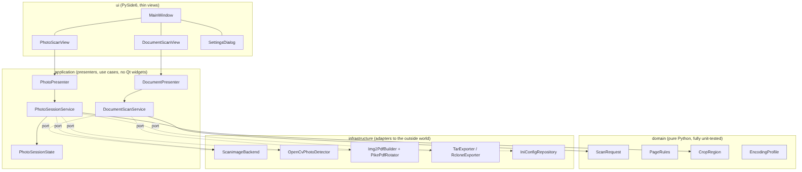
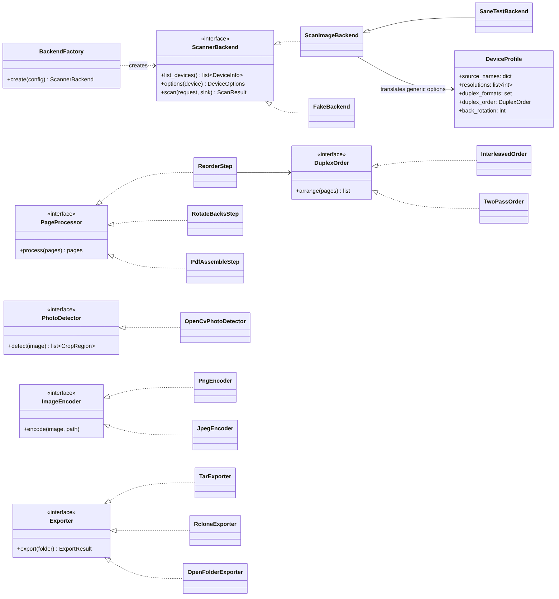
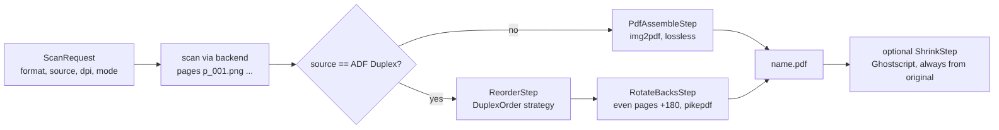
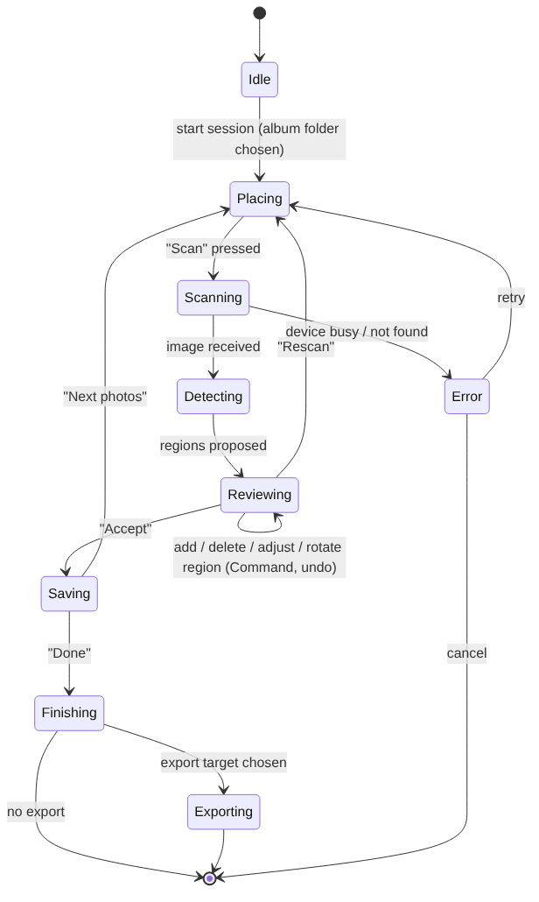
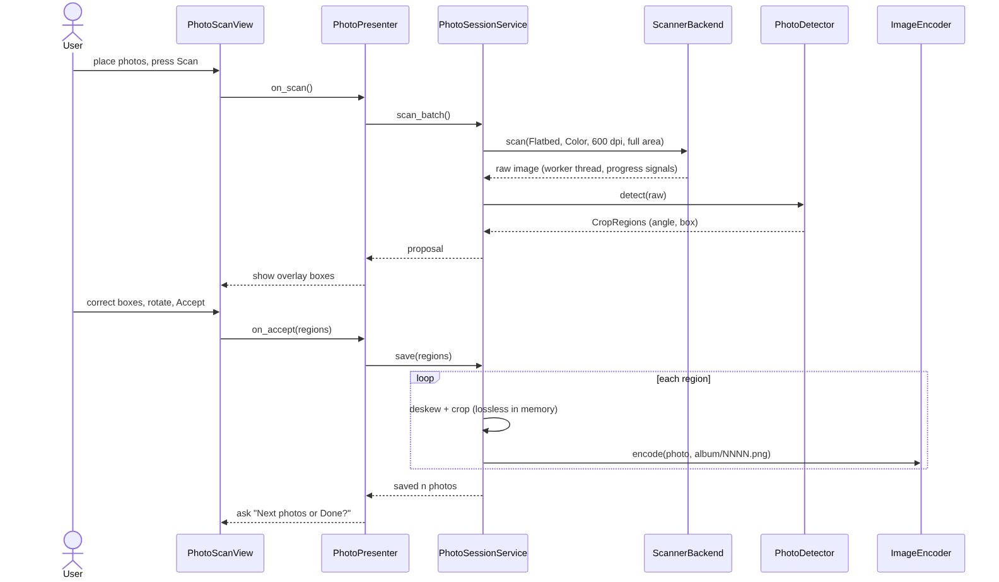
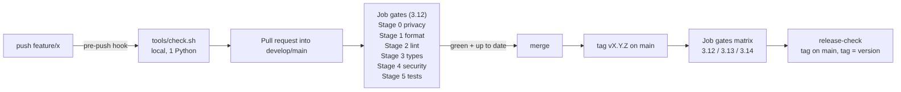

# Status and reading guide

| Part | Status |
|---|---|
| Input review (chapter 2) | done, based on the uploaded documents and the three project chats |
| Requirements, architecture, gates, CI | concept, not implemented |
| Photo detection | prototype run on synthetic scans (chapter 7.3); not yet run on a real scan |
| Commands in this document | proposals; none was run on the user's machines |

Decisions that only the user can make are collected in chapter 15. Terms are
explained in the glossary (chapter 17), sources with their check status in
chapter 18.

# Review of the input documents

## Which documents were used

| Document | Date | Role |
|---|---|---|
| Scanner reference MX920/MX925, revision 4 (file `scanner_format_matrix_6.pdf`) | 2026-10-08 | functional source for document scanning |
| Handover "Versioning and Quality Gates", revision 2 (mediatools) | 2026-11-10 | toolchain reference |
| Handover "patreon-downloader -- Quality Gates & Toolchain", USER.md, DEVELOPER.md | 2026-11-11 | staged runner, line-length decision, local update flow |
| Project chats "Canon MX925 Scannen unter Pop OS", "PDF und PNG Dateigröße", "IJ Scan Utility in VirtualBox" | June -- September 2026 | background, older states |

## Is revision 4 the newest scanner reference?

Within this project yes: the three project chats contain earlier states
(September 2026) that revision 4 explicitly corrects. The suffix `_6` in the
file name is a browser copy counter, not a revision number. Chats outside this
project cannot be searched from here; a later revision created elsewhere
cannot be excluded.

## Weaknesses found in revision 4

| # | Finding | Consequence for the app |
|---|---|---|
| W1 | The glossary entry "Duplex" says the ADF works "in two passes"; chapter 13 makes the alternating order (variant A) the default, and the user stated in the chat that each sheet is turned and scanned at once. The document contradicts itself. | Page order becomes a strategy object plus a calibration wizard (6.3), not a fixed rule. |
| W2 | Chapter 13.3 says the Canon software "sorts and rotates internally". Under variant A there is nothing to sort, only to rotate. | Wording only; no code impact. |
| W3 | Not verified on Ubuntu 26.04: duplex page order (no test with numbered sheets), flatbed scans, scans via the fixed device name, qpdf 12. | The app must not hard-wire these; first milestone includes the measurements. |
| W4 | The device name with the real IP address of the printer appears in every command. | Correct for a personal reference, but it must not reach a public repository (privacy rule); it moves to a local configuration file. |
| W5 | airscan offers only 150/300/600 dpi; 1200 dpi exists only via the pixma backend, whose ADF batch bug is documented. | Photo mode offers 300 and 600 dpi; higher values only if the device reports them. |
| W6 | Section numbering starts with "0.0". | Cosmetic. |

## Corrections to assumptions in the request

| Assumption in the request | Finding |
|---|---|
| Photos are placed on the "ADF plate" | Photos belong on the flatbed glass. The ADF pulls sheets through rollers; photo paper can be scratched or bent. Photo mode therefore uses `Flatbed` only. |
| "Python 3.1, 3.11 ..." | Read as 3.10. Python 3.10 reached end of life in October 2026 (mediatools handover); it is not supported here. |
| One CI Python version, e.g. 3.14 | Testing only the newest version does not detect code that fails on older interpreters. Pop!_OS 24.04 is based on Ubuntu 24.04 with Python 3.12, Debian 13 has 3.13, Ubuntu 26.04 has 3.14 (sources in 4.5). The single pull-request version must therefore be the **lowest** supported one (3.12); the full matrix runs on tags. |
| Matrix runs take "ages" because of virtual environments | Standard GitHub runners are free for public repositories, and a Free account runs up to 20 jobs concurrently; matrix jobs run in parallel, so wall time is roughly the slowest job, not the sum. The time goes into package installation and tests. Reducing pull-request runs to one job is still sensible: fewer runs, less noise, the same check names every time. |
| The app "reports with an icon" | Meant is a launcher entry with an icon (desktop file). A tray icon is not proposed: GNOME shows none without an extension. |
| GoF patterns "as far as possible" | Patterns are used where a real variation point exists (backends, page order, encoders, exporters). Patterns without a variation point add classes, not quality. |
| "Every block commented" | Every module, class and function gets a Google-style docstring (enforced by the lint gate). Inline comments explain *why*, not *what*; comments that repeat the code are not required. |

# Requirements

## Functional

| ID | Requirement |
|---|---|
| F1 | Document scan of the seven cases of the reference (A4/A5/A6 x flatbed/ADF, A4 ADF duplex) with 150/300/600 dpi, colour or grey, output PDF; optional PNG pages. |
| F2 | Duplex post-processing: page order by strategy (alternating or two-pass), rotation of back pages by 180 degrees (long edge) or none (short edge). |
| F3 | Calibration wizard for the duplex page order with two numbered sheets; result stored in the device profile. |
| F4 | Optional PDF shrinking with Ghostscript, always from the original (reference chapters 11 and 12). |
| F5 | Photo-album mode: flatbed, colour, 300 or 600 dpi, full scan area; automatic detection of all photos on the glass; user can add, delete, move, resize and rotate detected regions before saving. |
| F6 | Each accepted region is deskewed and cropped and saved as PNG (lossless, compression level selectable) or JPEG (quality and chroma subsampling selectable); optional downscaling to a target resolution. |
| F7 | Album loop: after each batch the app asks "next photos" or "done"; numbering continues across batches. |
| F8 | Export of the finished album folder: tar archive, upload to a pre-configured rclone remote (e.g. Google Drive, Nextcloud), or open the folder in the file manager. |
| F9 | Device detection and diagnosis: list devices, show options per backend, fixed device name with address, clear messages for "device busy" and "device not found" (reference chapter 14). |
| F10 | A CLI entry point for the same use cases, so that tests and scripts do not need the GUI. |

## Non-functional

| ID | Requirement |
|---|---|
| N1 | Runs on GNOME (X11 and Wayland), COSMIC (Wayland only), KDE Plasma and other freedesktop-compliant desktops without code changes. |
| N2 | Installation without root rights except for system packages (SANE, airscan backend). |
| N3 | No real device addresses, host names, user names or album names in the repository. |
| N4 | All code passes the six quality gates; branch coverage at least 90 %. |
| N5 | Long-running work (scan, detection, encoding, export) runs off the GUI thread; the GUI stays responsive and can cancel. |
| N6 | Originals are never overwritten; every processing step writes a new file. |

# Technology decisions

## GUI toolkit

| Criterion | PySide6 (Qt 6) | PyGObject (GTK 4) | Tkinter |
|---|---|---|---|
| Install into a venv with pip | wheels contain Qt | builds against system libraries; needs compiler and `-dev` packages | part of Python, but system package `python3-tk` |
| Wayland and X11 | yes | yes | X11 only, Wayland via Xwayland |
| Image view with overlay boxes, zoom | `QGraphicsView` | possible, more own code | limited |
| Undo/redo for region edits | `QUndoStack` (Command pattern built in) | own implementation | own implementation |
| Headless tests | pytest-qt with `QT_QPA_PLATFORM=offscreen` | possible | limited |
| Licence | LGPLv3 / GPL | LGPL | PSF |

**Decision: PySide6.** It fits the installation model "release tag into a
venv" of mediatools, because the PyPI wheels carry Qt itself, whereas PyGObject
must be compiled against system libraries. PySide6 supports Python 3.14 since
6.8.6/6.11.1; the current 6.12 wheels are `abi3` wheels for CPython 3.10 and
newer. To verify before pinning: the glibc level of the x86_64 wheel (the
aarch64 wheel of 6.12 is tagged `manylinux_2_39`, i.e. glibc 2.39, which
Ubuntu 24.04 and Debian 13 meet, Debian 12 does not).

## Scanner access

| Option | Assessment |
|---|---|
| `scanimage` as subprocess | Same tool as the reference; every option and quirk is documented there. External program called with an argument list via `shutil.which`, no shell, as the mediatools standard requires. |
| python-sane (libsane binding) | In-process, but needs `libsane-dev` and a compiler for installation; errors in a backend can crash the GUI process. |
| eSCL/WSD directly over HTTP | Would bypass SANE completely; much work, only network devices. |

**Decision: `scanimage` behind a `ScannerBackend` port** (Adapter pattern). A
python-sane adapter can be added later without touching the application layer.

## Image processing and PDF

| Purpose | Library | Reason |
|---|---|---|
| Photo detection, deskew, crop | `opencv-python-headless` | `findContours` and `minAreaRect` give region and angle. The headless wheel is mandatory: the normal `opencv-python` wheel brings its own Qt plugins and is known to break Qt applications with "could not load the Qt platform plugin xcb". |
| PNG/JPEG writing, metadata | Pillow | PNG compression level, JPEG quality, subsampling, DPI tag |
| Pages to PDF | `img2pdf` as library | lossless embedding, same tool as the reference, but in-process |
| Rotate back pages | `pikepdf` | binding to qpdf; wheels bundle qpdf, so the system `qpdf` of the reference is no longer needed |
| Shrink PDF | Ghostscript (`gs`), optional | as in reference chapter 11; feature disabled if `gs` is missing |

## Export

| Target | Implementation | Note |
|---|---|---|
| Archive | Python `tarfile` | uncompressed `.tar` by default: PNG and JPEG are already compressed; `.tar.gz`/`.tar.xz` selectable |
| Cloud | `rclone copy <folder> <remote>:<path>` | remote is configured by the user once with `rclone config`; covers Google Drive and Nextcloud (WebDAV). A direct Google Drive API client would need an OAuth client registration for a public app and is not planned for version 1. |
| File manager | `QDesktopServices.openUrl` | uses the desktop's default handler |

## Python versions

| Distribution | System Python |
|---|---|
| Ubuntu 24.04 / Pop!_OS 24.04 | 3.12 |
| Debian 13 trixie | 3.13 |
| Ubuntu 26.04 | 3.14 |

Proposal: `requires-python = ">=3.12"`. Pull requests test 3.12, tags test
3.12, 3.13 and 3.14.

## Desktop integration

* A desktop entry file following the Desktop Entry Specification 1.5 and an
  icon in the hicolor theme, installed per user below `~/.local/share`
  (no root rights).
* Application ID in reverse-DNS form, proposal `io.github.peddanet.scanbench`;
  the desktop file is named after it and the app calls
  `QGuiApplication.setDesktopFileName()` with the same ID, so that Wayland
  compositors map the window to the launcher icon. To verify on GNOME 50 and
  COSMIC.
* Flatpak is postponed: scanning from a sandbox needs access to SANE and the
  network backends, which is a separate project.

# Architecture

## Layers

{width=95%}

| Layer | Content | Depends on |
|---|---|---|
| `domain` | value objects and rules: `ScanRequest`, `PaperFormat`, `CropRegion`, `EncodingProfile`, `DuplexOrder` | nothing |
| `application` | use cases and presenters: `DocumentScanService`, `PhotoSessionService`, `PhotoPresenter` | `domain`, ports |
| `infrastructure` | adapters: `ScanimageBackend`, `OpenCvPhotoDetector`, `Img2PdfBuilder`, `TarExporter`, `IniConfigRepository` | external tools and libraries |
| `ui` | Qt widgets, no logic beyond display | `application` |

The presenters (Model-View-Presenter) contain the GUI logic but no widgets, so
they are tested without a display. Dependencies point inwards; the
composition root `main.py` wires adapters into services (constructor
injection, as in the mediatools coding standard).

## Classes and patterns

{width=80%}

| Pattern (GoF) | Where | Variation it absorbs |
|---|---|---|
| Adapter | `ScanimageBackend` | turns the `scanimage` CLI into the `ScannerBackend` port; translates generic options into backend names (`ADF` vs `Automatic Document Feeder`, reference 9.4) via `DeviceProfile` |
| Strategy | `DuplexOrder`, `ImageEncoder`, `Exporter`, `PhotoDetector` | page order per device, PNG/JPEG, export target, detection algorithm |
| Chain of Responsibility (as pipeline) | `PageProcessor` steps: reorder, rotate backs, assemble PDF, shrink | steps are added or skipped per scan case |
| Command | region edits (add, delete, move, rotate) as `QUndoCommand` | undo/redo in the review view |
| State | `PhotoSessionState` | allowed actions per phase (diagram 7.1) |
| Observer | Qt signals from worker objects | progress, results and errors to the GUI thread |
| Factory Method | `BackendFactory.create(config)` | real backend, SANE test backend or fake backend |
| Template Method | `ScanimageBackend._build_args()` overridden by `SaneTestBackend` | argument differences of the SANE `test` backend |
| Facade | `DocumentScanService`, `PhotoSessionService` | presenters see one entry point per use case |

## Package layout

~~~text
scanbench/
  pyproject.toml           version dynamic, tool sections of the gates
  CHANGELOG.md             Keep a Changelog, [Unreleased] on top
  README.md                overview, screenshots, install, quick start
  docs/user.md             user documentation
  docs/developer.md        architecture, UML (Mermaid), coding standard
  data/                    desktop file, icon (SVG), AppStream metainfo
  install.sh               install from a release tag into a venv
  tools/check.sh           six gates, staged output
  tools/privacy_scan.py    privacy gate
  .githooks/pre-push       runs tools/check.sh
  .github/workflows/       quality-gates.yml
  src/scanbench/
    __init__.py            __version__ = "X.Y.Z"
    main.py                composition root, CLI and GUI entry
    domain/                one class per module
    application/
    infrastructure/
    ui/
    i18n/                  Qt translation files (.ts, .qm)
  tests/
    unit/  integration/  gui/  data/
~~~

# Document scanning

## Pipeline

{width=100%}

The seven cases of reference chapter 5 become seven `ScanRequest` presets.
The pipeline reproduces the reference procedure, with two changes: PDF
assembly and back-page rotation run in-process (`img2pdf`, `pikepdf`), and
every step writes a new file, so the raw pages stay available until the user
deletes them.

## Device profile instead of fixed values

~~~ini
# ~/.config/scanbench/devices.ini  (example, not in the repository)
[mx925]
device = airscan:wsd:Canon MX920 series:http://192.168.0.10:80/wsd/scanservice.cgi
backend = airscan
duplex_formats = A4, Letter
duplex_order = interleaved
back_rotation = 180
max_width_mm = 215.9
~~~

The address above is a placeholder. The real address lives only in the local
file. Option names per backend (`ADF` vs `Automatic Document Feeder`) are
read from `scanimage -A` at runtime and cached, instead of being hard-coded.

## Duplex calibration wizard

Turns finding W1/W3 into a feature: the user marks two sheets 1V/1R and 2V/2R,
scans them in grey at 150 dpi, and the wizard shows the four raw pages. The
user clicks the page that shows "1R"; position 2 means interleaved, position 4
means two-pass. Then the user confirms whether 1R stands upright or upside
down. Both results go into the device profile.

# Photo-album scanning

## Session states

{width=85%}

## Flow of one batch

{width=100%}

## Detection: algorithm and prototype result

1. Convert to grey, Gaussian blur 5 x 5.
2. Estimate the lid brightness from a strip along the image edge.
3. Mask all pixels that differ from the lid brightness by more than a
   threshold; close gaps with a morphological closing.
4. Find outer contours; discard areas below a minimum size (default 30 mm x
   30 mm).
5. `minAreaRect` per contour gives centre, size and angle; the user sees the
   rotated boxes and can correct them.
6. Crop by an affine rotation of the region to the upright position, then
   cut; no re-encoding until the final encoder.

Prototype result (2026-11-11, OpenCV 5.0, synthetic A4 scans at 150 dpi with
three photos rotated by +3, -4 and +1.5 degrees on a light background):

| Case | Photos | Detected | Angle error |
|---|---|---|---|
| coloured photos without border | 3 | 3 | < 0.1 degree (angles reported modulo 90) |
| coloured photos with white border | 3 | 3 | < 0.1 degree |

Limits of this test: synthetic images without shadows, dust, lid texture or
photos touching each other. Known hard cases on real scans: very light photos
on the white lid, photos that touch. Mitigations: a sheet of black paper
between photos and lid, at least 5 mm gap between photos, and the manual
correction in the review view. The real check is part of milestone M3
(chapter 14).

## Resolution, memory and output

| Value | 300 dpi | 600 dpi |
|---|---|---|
| A4 area in pixels | 2480 x 3508 | 4961 x 7016 |
| Raw RGB in memory | approx. 26 MB | approx. 104 MB |

| Setting | Choices | Lossless? |
|---|---|---|
| Format | PNG, JPEG | PNG yes, JPEG no |
| PNG compression level | 0 to 9 | yes, every level; only time and size change |
| JPEG quality | 70 to 95 | no |
| JPEG chroma subsampling | 4:4:4 or 4:2:0 | no; 4:4:4 avoids colour fringes (reference 11.1) |
| Downscale to | off, 300, 200 dpi | no (resolution is reduced) |
| Alpha channel | always removed | yes (lesson from the PNG chat: unnecessary alpha) |

Album folder layout:

~~~text
<album>/
  0001.png ... 00NN.png    photos, numbering continues across batches
  album.json               per photo: batch, scan file, region, angle, encoder settings
  .raw/batch_001.png       raw scans, kept until the album is closed (ask before delete)
~~~

`album.json` makes every crop reproducible: a photo can be cut again from the
kept raw scan with corrected box or different encoder settings.

# Configuration, paths and privacy

| Item | Default (public) | Override for the user's convention |
|---|---|---|
| Settings, device profiles | `~/.config/scanbench/` | environment variable `SCANBENCH_HOME=~/scripts/scanbench.d` |
| Logs | `~/.local/state/scanbench/` | `$SCANBENCH_HOME/logs/` with date and time in the file name |
| Installed release | `~/.local/share/scanbench/venv` | `~/scripts/scanbench.d/venv` |
| Output folder | `~/Pictures/scanbench`, `~/Documents/scanbench` | selectable per job |

The XDG defaults serve other users of the published app; the user's rule
"everything below `~/scripts` and `~/Projects`" is met with one variable.
The privacy gate (gate 0) gets the local deny list with the device address,
host names and album names; the CI has no list and passes neutrally, as in
mediatools.

# Coding standard and measurable limits

| Rule | Value | Enforced by | Default of the tool |
|---|---|---|---|
| Line length | 100 | pycodestyle, pylint | 79 / 100 |
| Docstrings (Google style, Args/Returns/Raises) | every module, class, function | pylint + `docparams` | off |
| Arguments per function | 5 | pylint `max-args` | 5 |
| Local variables | 15 | pylint `max-locals` | 15 |
| Statements per function | 30 | pylint `max-statements` | 50 |
| Branches per function | 10 | pylint `max-branches` | 12 |
| Cyclomatic complexity | 10 | pylint extension `mccabe`, `max-complexity` | 10 |
| Lines per module | 400 | pylint `max-module-lines` | 1000 |
| Public methods per class | 10 | pylint `max-public-methods` | 20 |
| Type hints | complete, `disallow_untyped_defs` | mypy | off |
| One class per module | yes | review (no tool checks it) | -- |
| External programs | argument list via `shutil.which`, no shell, `check=` explicit | bandit, review | -- |

Line length 100 instead of the 120 of patreon-downloader: that deviation was
justified by 644 long German UI strings in existing code. Here the code is new
and the UI source strings are English, translated with Qt's translation files;
the reason for 120 does not apply.

# Quality gates and the staged runner

## Gates

The six gates of mediatools are taken over unchanged in content: 0 privacy,
1 format, 2 lint, 3 types, 4 security, 5 tests (branch coverage >= 90 %,
precision 2, `ResourceWarning` as error). The test gate refuses to run if
`scanimage` is missing, because skipped integration tests would lower the
coverage silently (mediatools lesson).

## Staged output (from patreon-downloader)

Each gate is a numbered stage with PASS/FAIL, duration and, on failure, a
summary instead of the full tool output; the full output of every gate goes to
a log directory. Options: `--fast` (skip tests), `--full` (full output
inline), `--json FILE` (summary for scripts and CI), and new `--only GATE`
(one gate; used by the CI to show each gate as its own step). Example of the
intended output (mock-up, not real output):

~~~text
==== scanbench quality gates ============================ 2026-11-11 01:40:12
-- [0] privacy   tools/privacy_scan.py ............................ PASS   0.4 s
-- [1] format    pycodestyle --max-line-length=100 ................ PASS   1.1 s
-- [2] lint      pylint + docparams + mccabe ...................... FAIL   9.8 s
       score 9.87/10, 3 findings
         missing-param-doc    src/scanbench/infrastructure/opencv_detector.py:41
         too-complex (12>10)  src/scanbench/application/photo_session.py:88
         line-too-long        tests/unit/test_tar_exporter.py:17
       full output: .gates/2026-11-11_01-40-12/2-lint.log
-- [3] types     skipped (stopped at first failure)
-- [4] security  skipped
-- [5] tests     skipped
==== RESULT: FAIL at [2] lint, 3 of 6 stages run, 11.3 s ===================
~~~

## Test levels

| Level | Tooling | Needs scanner |
|---|---|---|
| Unit (domain, presenters) | pytest | no |
| Adapters with a fake `scanimage` | pytest, script on `PATH` | no |
| Integration with the SANE `test` backend | `scanimage -d test` (simulates flatbed and an ADF that is empty after 10 scans) | no |
| Photo detection | golden images in `tests/data/`, synthetic and real (anonymised) | no |
| GUI | pytest-qt, `QT_QPA_PLATFORM=offscreen` (no Xvfb needed) | no |
| Hardware acceptance | manual checklist per release | yes |

The SANE `test` backend is commented out in `/etc/sane.d/dll.conf`; the man
page names explicit calling with `-d test` as the alternative, so no
configuration change is needed.

# CI on GitHub Actions

## Lean pipeline

{width=100%}

| Event | Jobs | Purpose |
|---|---|---|
| pull request into `develop`/`main` | `gates` (Python 3.12), one step per gate | required check, merge only when green |
| tag `v*` | `gates-matrix` (3.12, 3.13, 3.14) + `release-check` | release gate |
| branch push | none | covered by pull request (mediatools lesson) |
| manual (`workflow_dispatch`) | `gates` | branch without pull request |

Each gate is its own step, named like the local stage, so the GitHub run page
shows the six stages as separate, collapsible entries; the `--json` summary is
appended to the job summary page (`GITHUB_STEP_SUMMARY`). Branch protection
requires only the context `gates`; the matrix on tags does not block merges,
so the protection does not need to change when the matrix changes.

Workflow draft (untested), part 1 of 2:

~~~yaml
name: quality-gates
on:
  pull_request:
    branches: [main, develop]
  push:
    tags: ["v*"]
  workflow_dispatch:

jobs:
  gates:
    if: github.event_name != 'push'
    runs-on: ubuntu-24.04
    env:
      QT_QPA_PLATFORM: offscreen
    steps:
      - uses: actions/checkout@v4
      - uses: actions/setup-python@v6
        with:
          python-version: "3.12"
          cache: pip
      - run: sudo apt-get update && sudo apt-get install -y sane-utils ghostscript
      - run: pip install -e ".[dev]"
      - name: "[0] privacy"
        run: tools/check.sh --only privacy
      - name: "[1] format"
        run: tools/check.sh --only format
      - name: "[2] lint"
        run: tools/check.sh --only lint
      - name: "[3] types"
        run: tools/check.sh --only types
      - name: "[4] security"
        run: tools/check.sh --only security
      - name: "[5] tests"
        run: tools/check.sh --only tests --json gates.json
      - if: always()
        run: python3 tools/summary.py gates.json >> "$GITHUB_STEP_SUMMARY"
~~~

Part 2 of 2:

~~~yaml
  gates-matrix:
    if: startsWith(github.ref, 'refs/tags/v')
    runs-on: ubuntu-24.04
    strategy:
      fail-fast: false
      matrix:
        python: ["3.12", "3.13", "3.14"]
    env:
      QT_QPA_PLATFORM: offscreen
    steps:
      - uses: actions/checkout@v4
      - uses: actions/setup-python@v6
        with:
          python-version: ${{ matrix.python }}
          cache: pip
      - run: sudo apt-get update && sudo apt-get install -y sane-utils ghostscript
      - run: pip install -e ".[dev]"
      - run: tools/check.sh

  release-check:
    if: startsWith(github.ref, 'refs/tags/v')
    needs: gates-matrix
    runs-on: ubuntu-24.04
    steps:
      - uses: actions/checkout@v4
        with:
          fetch-depth: 0
      - run: git merge-base --is-ancestor "$GITHUB_SHA" origin/main
      - run: |
          v=$(sed -n 's/^__version__ = "\(.*\)"/\1/p' src/scanbench/__init__.py)
          test "v$v" = "$GITHUB_REF_NAME" || { echo "tag != v$v"; exit 1; }
~~~

To verify when implementing: whether the Qt `offscreen` platform plugin
needs further system libraries on the runner image; whether `tools/summary.py`
is worth a separate script or belongs into `check.sh`.

## Branch protection

As in mediatools section 4.1 (owner, `gh` with the owner's token, no local
privilege), with `"contexts": ["gates"]`. Squash and rebase merging disabled,
`strict` on, no force push.

# Installation and delivery

## Installation for users

~~~bash
sudo apt install sane-utils sane-airscan
curl -fsSLO https://raw.githubusercontent.com/peddanet/scanbench/main/install.sh
bash install.sh
scanbench --install-desktop
~~~

| Line | Privilege | Why |
|---|---|---|
| 1 | `sudo` from the user context | system packages are written below `/usr`; package names to verify per distribution |
| 2 | normal user | downloads the installer into the current directory |
| 3 | normal user | newest release tag into a venv below the home directory; no `sudo pip` (PEP 668) |
| 4 | normal user | desktop file and icon below `~/.local/share` |

Reading `install.sh` before running it is recommended in the README; the
script itself does nothing outside the home directory.

## Delivery by the assistant and updates

Unchanged from mediatools: the assistant works in its own clone, runs
`tools/check.sh`, delivers `git format-patch` archives and never pushes. Because
scanbench is public on GitHub, the `update` command follows the mediatools
variant (pull requests, CI runs, tag); the local rebase variant of
patreon-downloader remains the model for a later Forgejo-only project.

# Documentation set

| File | Audience | Content |
|---|---|---|
| `README.md` | everyone on GitHub | purpose, screenshots, supported scanners, install, quick start, licence |
| `docs/user.md` | users | document scan, photo album, export, device setup, troubleshooting (from reference 9 and 14) |
| `docs/developer.md` | contributors | layers, class, state and sequence diagrams, patterns, coding standard, gates, release flow |
| `CONTRIBUTING.md` | contributors | branch model, gate expectations, commit style |
| `CHANGELOG.md` | everyone | Keep a Changelog |
| `docs/devices.md` | users | tested devices with backend, options and known quirks; MX925 as first entry |

Diagrams are written in Mermaid inside the Markdown files; GitHub renders
them directly, and the same sources produce the images of this concept.

# Milestones

| Milestone | Content | Exit criterion |
|---|---|---|
| M0 | repository skeleton, gates, staged runner, CI, desktop entry, empty window | all gates green in CI |
| M1 | backend adapter, device detection, device profile, CLI for the seven cases | SANE `test` backend tests green; real MX925: ADF simplex A4 |
| M2 | document GUI, duplex pipeline, calibration wizard, shrinking | duplex order measured with numbered sheets and stored |
| M3 | photo mode: detection, review view with undo, encoders, album loop | real scan with three photos detected and saved |
| M4 | export (tar, rclone, folder), user and developer documentation | release 1.0.0, published |

# Decisions for the user

| # | Question | Proposal |
|---|---|---|
| D1 | Project name | "scanbench" is a working title; check GitHub/PyPI for collisions |
| D2 | Licence | GPL-3.0-or-later or MIT; both are compatible with PySide6 under LGPLv3 when the wheel is used unmodified (not legal advice) |
| D3 | UI language | English source strings, German translation included |
| D4 | Minimum Python | 3.12 |
| D5 | Default paths | XDG for the public; `SCANBENCH_HOME` for the `~/scripts` convention |
| D6 | Keep raw scans of an album | yes until the album is closed, then ask |

# Risks

| Risk | Effect | Measure |
|---|---|---|
| Real duplex order differs from the assumption | wrong page order | calibration wizard (6.3) |
| Light photos on the white lid not detected | manual work | black backing sheet, manual regions |
| airscan device name changes (reference 14) | device not found | fixed name with address in the profile, diagnosis view |
| Another program holds the scanner (simple-scan) | scan fails | clear message naming the blocking process, no automatic kill |
| Qt/Wayland icon mapping differs on COSMIC | generic icon in the dock | test on Pop!_OS in M0 |
| PySide6 wheel requires a newer glibc than a target distribution | install fails | pin a PySide6 version whose wheel tag fits, document supported distributions |

# Glossary

**abi3 wheel** -- binary Python package built against the stable ABI; one wheel serves several Python versions. [Python packaging: platform compatibility tags](https://packaging.python.org/en/latest/specifications/platform-compatibility-tags/)

**Adapter** -- GoF pattern that converts one interface into another expected by the client. [Refactoring.Guru: Adapter](https://refactoring.guru/design-patterns/adapter)

**ADF** -- automatic document feeder; pulls sheets through the scanner.

**airscan (sane-airscan)** -- SANE backend for network scanners speaking eSCL or WSD. [sane-airscan](https://github.com/alexpevzner/sane-airscan)

**AppStream metainfo** -- XML file that describes an application for software centres. [AppStream](https://www.freedesktop.org/software/appstream/docs/)

**bandit** -- security linter for Python. [bandit](https://bandit.readthedocs.io/)

**Chain of Responsibility** -- GoF pattern passing a request along a chain of handlers; here used as a processing pipeline. [Refactoring.Guru: Chain of Responsibility](https://refactoring.guru/design-patterns/chain-of-responsibility)

**Chroma subsampling** -- reduced colour resolution in JPEG (e.g. 4:2:0); causes colour fringes at sharp edges.

**Command** -- GoF pattern that turns an action into an object, enabling undo/redo. [Qt: QUndoStack](https://doc.qt.io/qt-6/qundostack.html)

**COSMIC** -- Rust-based, Wayland-only desktop of System76, default in Pop!_OS 24.04.

**Cyclomatic complexity (McCabe)** -- number of independent paths through a function. [pylint optional checkers](https://pylint.readthedocs.io/en/latest/user_guide/checkers/extensions.html)

**Desktop entry** -- `.desktop` file that registers an application with menus and launchers. [Desktop Entry Specification](https://specifications.freedesktop.org/desktop-entry-spec/latest/)

**Deskew** -- rotating a scanned object so that its edges are axis-parallel.

**Facade** -- GoF pattern offering one simple entry point to a subsystem. [Refactoring.Guru: Facade](https://refactoring.guru/design-patterns/facade)

**Factory Method** -- GoF pattern deferring the choice of a concrete class to a creator method. [Refactoring.Guru: Factory Method](https://refactoring.guru/design-patterns/factory-method)

**Gang of Four (GoF)** -- the four authors of "Design Patterns" (1994) and their 23 patterns.

**hicolor** -- fallback icon theme every freedesktop desktop searches. [Icon Theme Specification](https://specifications.freedesktop.org/icon-theme-spec/latest/)

**img2pdf** -- lossless conversion of raster images to PDF. [img2pdf on PyPI](https://pypi.org/project/img2pdf/)

**manylinux** -- tag of Linux wheels stating the minimum glibc version. [PEP 600](https://peps.python.org/pep-0600/)

**minAreaRect** -- OpenCV function returning the smallest rotated rectangle around a contour. [OpenCV: contour features](https://docs.opencv.org/4.x/dd/d49/tutorial_py_contour_features.html)

**Model-View-Presenter (MVP)** -- GUI pattern where the presenter holds the logic and the view only displays.

**Observer** -- GoF pattern notifying subscribers of changes; in Qt realised as signals and slots. [Qt: signals and slots](https://doc.qt.io/qt-6/signalsandslots.html)

**offscreen platform** -- Qt platform plugin that renders without a display; used for headless tests. [pytest-qt troubleshooting](https://pytest-qt.readthedocs.io/en/latest/troubleshooting.html)

**PEP 668** -- marks the system Python as externally managed. [PEP 668](https://peps.python.org/pep-0668/)

**pikepdf** -- Python binding to qpdf for PDF manipulation. [pikepdf on PyPI](https://pypi.org/project/pikepdf/)

**Port** -- interface owned by the application layer and implemented by an adapter (hexagonal architecture).

**PySide6** -- official Python binding of Qt 6. [Qt for Python](https://doc.qt.io/qtforpython-6/)

**rclone** -- command-line program that copies files to many cloud storages. [rclone documentation](https://rclone.org/docs/)

**SANE** -- Scanner Access Now Easy, scanner framework of Linux. [SANE project](http://www.sane-project.org/)

**SANE test backend** -- SANE backend that simulates scanners for testing frontends. [sane-test(5)](https://manpages.ubuntu.com/manpages/noble/man5/sane-test.5.html)

**State** -- GoF pattern changing an object's behaviour with its internal state. [Refactoring.Guru: State](https://refactoring.guru/design-patterns/state)

**Strategy** -- GoF pattern making algorithms interchangeable behind one interface. [Refactoring.Guru: Strategy](https://refactoring.guru/design-patterns/strategy)

**Template Method** -- GoF pattern defining an algorithm skeleton with overridable steps. [Refactoring.Guru: Template Method](https://refactoring.guru/design-patterns/template-method)

**Wayland app ID** -- identifier of a window that compositors match with the desktop file name. [Qt: QGuiApplication::desktopFileName](https://doc.qt.io/qt-6/qguiapplication.html#desktopFileName-prop)

**XDG base directories** -- standard locations for configuration, data and state below the home directory. [XDG Base Directory Specification](https://specifications.freedesktop.org/basedir-spec/latest/)

Further terms (quality gates, git-flow, branch protection, matrix, pre-push hook, Semantic Versioning, Keep a Changelog) are explained in the glossary of the mediatools handover, revision 2.

# Sources

Status 2026-11-11. "search" = content seen in search results, page not opened
by the assistant; "prototype" = behaviour measured in the assistant's
environment; "document" = uploaded document of the user. The links of the
glossary that are not listed here are standard references and were not
checked individually.

| Source | Status | Used for |
|---|---|---|
| Scanner reference MX920/MX925, revision 4 | document | chapters 2, 6 |
| Handover mediatools, revision 2; handover patreon-downloader with USER.md, DEVELOPER.md | document | chapters 9 to 12 |
| [PySide6 release notes 6.11](https://doc.qt.io/qtforpython-6.11/release_notes/pyside6_release_notes.html), [6.8](https://doc.qt.io/qtforpython-6.8/release_notes/pyside6_release_notes.html) | search | Python 3.14 support |
| [PySide6 on PyPI](https://pypi.org/pypi/PySide6) | search | 6.12 abi3 wheels, `manylinux_2_39` (aarch64) |
| [PyGObject: getting started](https://pygobject.gnome.org/getting_started.html), [development environment](https://pygobject.gnome.org/devguide/dev_environ.html) | search | build dependencies |
| [Qt forum: opencv-python and Qt platform plugin xcb](https://forum.qt.io/topic/119109/using-pyqt5-with-opencv-python-cv2-causes-error-could-not-load-qt-platform-plugin-xcb-even-though-it-was-found/7) | search | headless OpenCV wheel |
| [OpenCV: contour features](https://docs.opencv.org/4.x/dd/d49/tutorial_py_contour_features.html) | search; prototype | `minAreaRect` |
| [img2pdf on PyPI](https://pypi.org/project/img2pdf/), [pikepdf on PyPI](https://pypi.org/project/pikepdf/) | search | in-process PDF steps, bundled qpdf |
| [rclone documentation](https://rclone.org/docs/) | search | export to cloud remotes |
| [Ubuntu packages: python3 in resolute (26.04)](https://packages.ubuntu.com/resolute/python3) | search | Python 3.14 |
| [Debian packages: python3 in trixie](https://packages.debian.org/trixie/python3) | search | Python 3.13 |
| [Ubuntu 26.04 developer details (issoh.co.jp)](https://www.issoh.co.jp/tech/details/11942/) | search | 24.04 = 3.12, 26.04 = 3.14 only |
| [Pop!_OS 24.04 beta with COSMIC (OMG! Ubuntu)](https://www.omgubuntu.co.uk/2025/09/pop_os-24-04-with-cosmic-is-now-in-beta), [stable release (AlternativeTo)](https://alternativeto.net/news/2025/12/system76-launches-first-stable-versions-of-pop-_os-24-04-lts-and-cosmic-desktop) | search | base Ubuntu 24.04, Wayland only, GTK/Qt apps supported |
| [GitHub Docs: Actions limits](https://docs.github.com/en/actions/reference/limits), [billing](https://docs.github.com/en/actions/reference/usage-limits-billing-and-administration) | search | 20 concurrent jobs (Free), free standard runners for public repositories |
| [GitHub Docs: workflow commands](https://docs.github.com/en/actions/reference/workflows-and-actions/workflow-commands) | search | log groups, job summary |
| [sane-test(5), Ubuntu noble](https://manpages.ubuntu.com/manpages/noble/man5/sane-test.5.html), [mankier](https://www.mankier.com/5/sane-test) | search | test backend, ADF empty after 10 scans, `-d test` |
| [pytest-qt troubleshooting](https://pytest-qt.readthedocs.io/en/latest/troubleshooting.html) | search | `QT_QPA_PLATFORM=offscreen` |
| [pylint optional checkers (mccabe)](https://pylint.readthedocs.io/en/latest/user_guide/checkers/extensions.html) | search | `max-complexity`, default 10 |
| [Desktop Entry Specification](https://specifications.freedesktop.org/desktop-entry-spec/latest/) | search | version 1.5, keys |
| Prototype `detect.py`, 2026-11-11 | prototype | chapter 7.3 |

Not verified and therefore marked in the text: the pylint defaults other than
`max-complexity` (taken from the pylint documentation from memory, to confirm
with `pylint --generate-toml-config`), the Debian package name `sane-airscan`,
the glibc tag of the x86_64 PySide6 wheel, the Wayland icon mapping on COSMIC.
