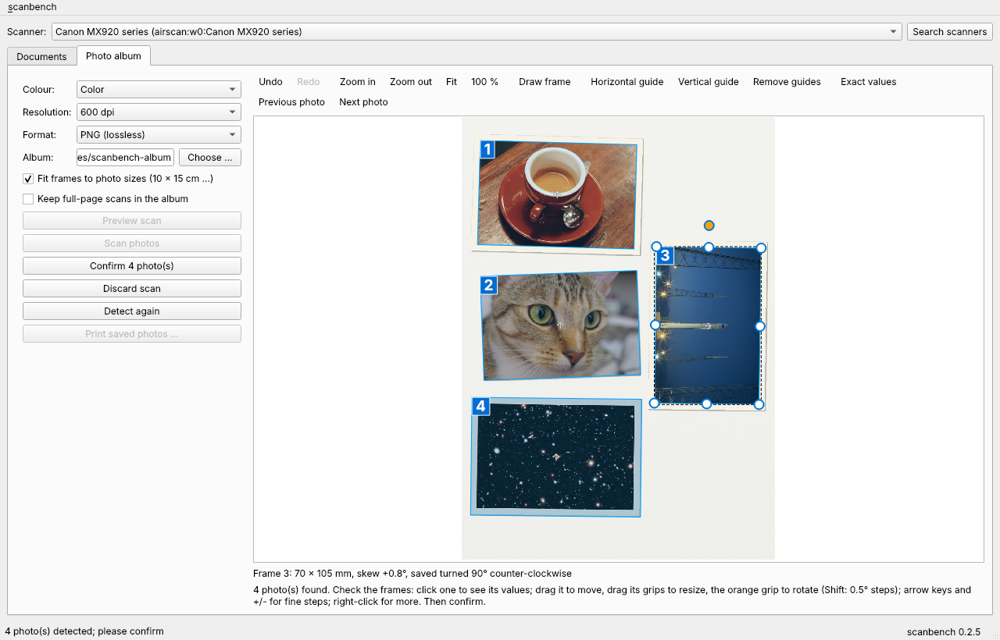
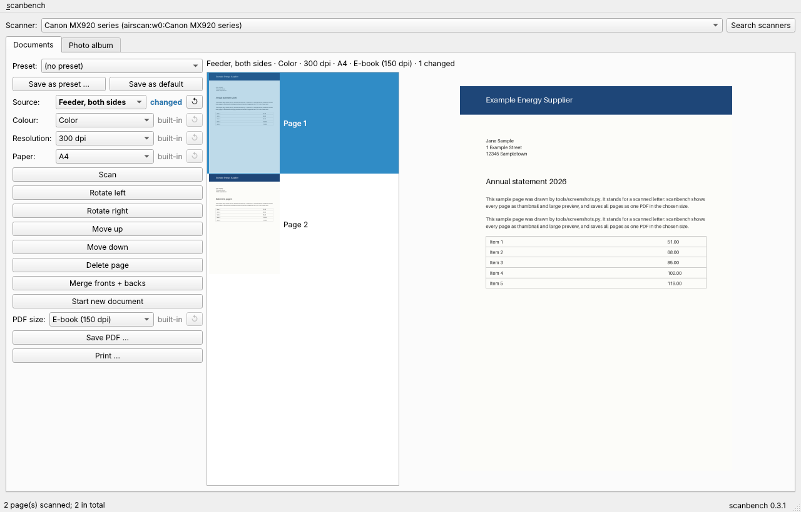
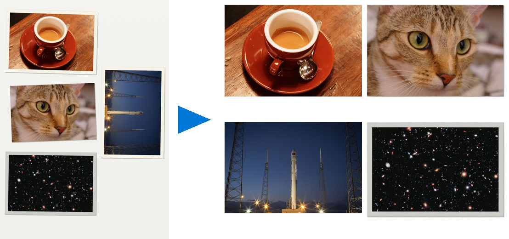
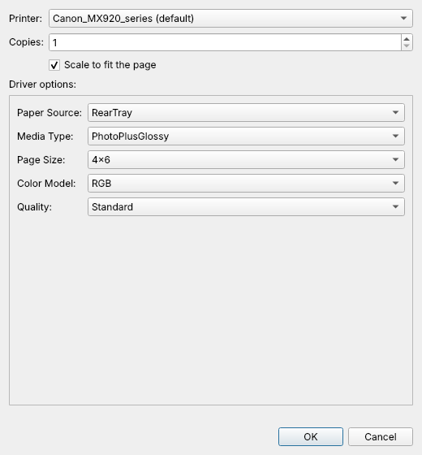

# scanbench user guide

Back to: [Documentation home](../README.md)

The complete user documentation in one page. Terms are explained in the
[glossary](../glossary.md).

## Contents

1. [Overview](#1-overview)
2. [Installation](#2-installation)
3. [Starting, commands and files](#3-starting-commands-and-files)
4. [Choosing the scanner](#4-choosing-the-scanner)
5. [Scanning documents](#5-scanning-documents)
6. [Scanning photo albums](#6-scanning-photo-albums)
7. [Printing](#7-printing)
8. [Updating](#8-updating)
9. [Troubleshooting](#9-troubleshooting)
10. [Settings and presets](#10-settings-and-presets)
11. [References](#11-references)

## 1. Overview

| Tab or function | What it does |
|---|---|
| Documents | scan from flatbed or feeder, one or both sides; arrange pages; save as PDF in five sizes; print |
| Photo album | scan the full A4 glass; find every photo; check and correct the frames; save each photo straightened as PNG or JPEG; print |
| Printing | every CUPS printer with all options of its driver, e.g. photo tray or CD/DVD tray |
| Updates | every release in its own environment; an open window switches when it is idle |

The screenshots show the real program with simulated scanner input from
copyright-free sample photos ([sources](img/samples/SOURCES.md)).

## 2. Installation

scanbench installs per user into its own virtual environment. Only the system
packages need administrator rights.

### 2.1 System packages

~~~bash
sudo apt install sane-utils sane-airscan ghostscript cups-client
~~~

| Package | Provides | Needed for |
|---|---|---|
| `sane-utils` | `scanimage`, the SANE command line program scanbench calls | scanning (required) |
| `sane-airscan` | SANE backend for network scanners (eSCL, WSD) | network scanners |
| `ghostscript` | `gs` | reduced PDF sizes (optional; without it only lossless PDFs) |
| `cups-client` | `lp`, `lpstat`, `lpoptions` | printing (optional; usually installed) |

Privilege: `sudo` from your user context, because packages are written below
`/usr`; a root shell is not needed. Package names are those of Debian and
Ubuntu (including Pop!_OS). The Python libraries (Qt, OpenCV, NumPy, Pillow,
img2pdf, tomli-w) come with `install.sh` into the release environment.

### 2.2 Install a release

~~~bash
curl -fsSLO https://raw.githubusercontent.com/peddanet/scanbench/main/install.sh
less install.sh
bash install.sh
~~~

| Line | What it does | Privilege |
|---|---|---|
| 1 | downloads the installer; `-f` fail on HTTP errors, `-sS` quiet but show errors, `-L` follow redirects, `-O` keep the file name | normal user |
| 2 | lets you read the script before running it | normal user |
| 3 | finds the newest release tag, creates `venvs/X.Y.Z`, installs, checks the version, switches the link `venv`, links the launcher, adds the desktop entry | normal user; writes only below your home directory |

A specific release: `bash install.sh v0.2.1`.

### 2.3 Where the installation goes

| Variable | Default | Meaning |
|---|---|---|
| `SCANBENCH_HOME` | `~/.local/share/scanbench` | root of the installation; if set, configuration, logs and cache move below it too |
| `SCANBENCH_BIN` | `~/.local/bin` | directory of the `scanbench` launcher link |

Everything in one folder below `~/scripts`:

~~~bash
export SCANBENCH_HOME=~/scripts/scanbench.d SCANBENCH_BIN=~/scripts
bash install.sh
~~~

Put the `export` line into `~/.profile` as well. The launcher entry in the
application menu carries both values itself, because programs started from
the menu do not necessarily see `~/.profile`.

### 2.4 Launcher entry

`install.sh` runs `scanbench install-desktop`, which writes
`~/.local/share/applications/io.github.peddanet.scanbench.desktop` and the
icon `~/.local/share/icons/hicolor/scalable/apps/io.github.peddanet.scanbench.svg`.
The entry starts `<installation>/venv/bin/scanbench`, a link that stays valid
across releases. `scanbench uninstall-desktop` removes both files.

### 2.5 Uninstall

~~~bash
scanbench uninstall-desktop
rm -r ~/.local/share/scanbench
rm ~/.local/bin/scanbench
~~~

Normal user, everything is in your home directory. Adjust the paths if you
set `SCANBENCH_HOME` or `SCANBENCH_BIN`. Settings in `~/.config/scanbench`
stay unless you delete them too.

## 3. Starting, commands and files

Start from the application menu, or with `scanbench` in a terminal. The status
bar shows the version; **scanbench > About scanbench** shows it as well.

| Command | Purpose |
|---|---|
| `scanbench` or `scanbench gui` | start the graphical interface |
| `scanbench doctor` | version, directories, external programs; exit status 1 if a required program is missing |
| `scanbench devices [--test]` | scanners with sources, modes, resolutions; `--test` adds SANE's virtual scanner |
| `scanbench printers` | CUPS printers, the default printer, driver options |
| `scanbench install-desktop` / `uninstall-desktop` | add or remove the launcher entry |
| `scanbench update` | maintainer: turn delivered patch archives into releases ([section 8.3](#83-maintainer-release-delivered-patches)) |
| `scanbench publish` | maintainer: first publication on GitHub |
| `scanbench --version` | print the version |

All commands run as normal user.

| Content | Default | With `SCANBENCH_HOME` |
|---|---|---|
| Settings (album folder) | `~/.config/scanbench` | `$SCANBENCH_HOME/config` |
| Logs: `scanbench.log` (start, end, every status text, errors with traceback; rotated at 1 MB, 5 files) and `crash.log` (call stacks after a hard crash) | `~/.local/state/scanbench/logs` | `$SCANBENCH_HOME/logs` |
| Sessions and the handover to a new release | `~/.local/share/scanbench/sessions` | `$SCANBENCH_HOME/sessions` |
| Raw scans of the running session, deleted on exit | `~/.cache/scanbench/session-*` | `$SCANBENCH_HOME/cache/session-*` |
| Scanners and their options from the last run (`devices.json`; may be deleted, it is rebuilt) | `~/.cache/scanbench` | `$SCANBENCH_HOME/cache` |
| Installed releases | `~/.local/share/scanbench/venvs/X.Y.Z`, active one linked as `venv` | `$SCANBENCH_HOME/venvs/X.Y.Z` |
| Applied patch archives | `~/.local/share/scanbench/releases` | `$SCANBENCH_HOME/releases` |

## 4. Choosing the scanner

The bar above the tabs lists every scanner SANE can reach. Sources, colour
modes and resolutions in both tabs follow the selected scanner.

Searching takes several seconds with network scanners, so scanbench does not
wait for it:

- At start the bar shows at once the scanners of the last run, with the last
  used one selected and its remembered options; you can scan right away. The
  status bar says "… known from the last run; searching in the background".
- The search runs in the background. Its result replaces the list; the
  selected scanner stays selected. A scanner that is no longer found is
  named in the status bar.
- If you choose a scanner before the search has finished, scanbench reads its
  options at once; this also checks that it can be reached ("Scanner not
  reachable: …" otherwise).
- **Search scanners** searches again and reads the options of the selected
  scanner anew (e.g. after a firmware update).

Without hardware, try SANE's virtual scanner (normal user, this start only):

~~~bash
SCANBENCH_TEST_DEVICE=1 scanbench
~~~

## 5. Scanning documents

### 5.1 Settings

| Setting | Choices | Notes |
|---|---|---|
| Source | Flatbed · Feeder, one side · Feeder, both sides | only what the scanner offers |
| Colour | Color · Gray · Black and white | black and white (line art) gives the smallest files for text |
| Resolution | as offered, e.g. 75 to 1200 dpi | 300 dpi for documents, 150 dpi for screen reading |
| Paper | A4 · A5 · A6 · Letter | limited to the scanner's maximum area |

### 5.2 Scan and arrange

| Action | How |
|---|---|
| scan | **Scan**: one page from the flatbed, or every sheet in the feeder |
| more pages | **Scan** again; new pages are appended |
| turn a page | select it, **Rotate left/right**, or right-click: 90°, 180° |
| reorder | **Move up / Move down** |
| remove | **Delete page** or right-click > Delete page |
| start over | **Start new document** |

Rotations are applied when saving, so editing never degrades the scan.

**Two-sided without a duplex feeder (manual duplex):** scan the stack, turn it
over without re-sorting, scan again, then **Merge fronts + backs**. The runs
are interleaved into reading order; both must have the same number of sheets.

### 5.3 Save as PDF

| PDF size | Ghostscript preset | Typical use |
|---|---|---|
| Original (lossless) | none | archive; pages embedded unchanged with img2pdf |
| Screen (72 dpi) | `/screen` | smallest file, screen only |
| E-book (150 dpi) | `/ebook` | e-mail, reading on screen (default) |
| Printer (300 dpi) | `/printer` | printing |
| Prepress (300 dpi, best) | `/prepress` | printing with the highest quality |

Every reduced size is made from the lossless original. If a reduction would
not be smaller (possible with black-and-white pages), the lossless file is
kept. **Print ...** prints the lossless pages ([section 7](#7-printing)).

## 6. Scanning photo albums

### 6.1 Placing the photos

- Up to four photos fit on the A4 glass, e.g. three 10 x 15 cm landscape
  photos and one portrait photo, or three postcards.
- A few millimetres between the photos help, but photos lying edge to edge
  are separated as well: along a light seam, or along the edge line between
  two photos of a standard size (9 x 13, 10 x 15, postcard A6, 13 x 18 cm).
- Skewed or 90-degree turned photos are detected. Close the lid.

### 6.2 Settings

| Setting | Default | Notes |
|---|---|---|
| Colour | Color | Gray for black-and-white photos |
| Resolution | 600 dpi | 300 dpi for small prints, 600 dpi for archiving |
| Format | PNG (lossless) | JPEG (quality 92) is about a tenth of the size |
| Album | `~/Pictures/scanbench-album` | remembered across restarts |
| Fit frames to photo sizes | on | frames within 6 % of 9 x 13, 10 x 15, postcard A6 or 13 x 18 cm get exactly that size, but never grow by more than 1 mm per side (that would show the lid) |
| Keep full-page scans | off | also stores the whole page in `scans/` |

### 6.3 Preview first, then scan only the photos

High resolutions take long for the whole glass (a full A4 page at 1200 dpi
takes minutes). The fast way:

| Step | Button | What happens |
|---|---|---|
| 1 | **Preview scan** | the whole glass at the lowest resolution of at least 75 dpi; the photos are found |
| 2 | correct the frames | as in [section 6.4](#64-check-and-correct-the-frames); delete or draw frames |
| 3 | **Scan photos** | only the area around all frames (plus 3 mm) at the chosen resolution; the frames are taken over |
| 4 | **Confirm N photo(s)** | as in [section 6.5](#65-confirm-and-continue) |

Every photo page starts with the preview scan (decision D10); the whole
glass is never scanned at full resolution. A preview cannot be confirmed.

**Progress:** while scanning, the image builds up in the preview and the
status bar shows a progress bar and e.g. `Page 1 of 1 · 45 % · 0:12 · about
0:15 left`; in the feeder the page count is `Page 3 of ?`.

**Cancel:** while a job runs, **Cancel (Esc)** appears below the scan buttons
of the tab (and in the status bar); the **Esc** key does the same.

| Job | What Cancel does |
|---|---|
| scan (flatbed, feeder, preview, Scan photos) | stops `scanimage`; pages already scanned from the feeder are kept |
| Detect again | the running detection finishes, its result is discarded; the previous frames stay |
| Confirm (saving photos) | stops before the next photo; saved photos stay in the album, the frames not yet saved keep waiting and **Confirm** saves only those |
| Save PDF, Print | cannot be cancelled (they take seconds) |

The status bar then says e.g. `Cancelled - Saved 1 photo(s); 1 still waiting`.

| Scanner backend | Resolutions | Note |
|---|---|---|
| `pixma` (USB or network) | up to 2400 dpi | the preview is worth it from 600 dpi on |
| `airscan` (eSCL) | usually 150, 300, 600 dpi | the backend decides what it offers |

### 6.4 Check and correct the frames

After a scan every found photo has a blue frame with its number in a blue box
at the top-left corner (the number of the photo in this scan, also used in
`album.json`) and an arrow pointing to the side that becomes the top. The
sides are placed on the photo edges at full resolution: lid colour, a light
strip up to 1.5 mm and the grey shadow line along an edge are left outside.
A print border that clearly differs from the lid (grey, coloured) stays part
of the photo; a white or cream border close to the lid colour cannot be told apart
from the lid and may be left outside, as with prints 1 and 3 in the picture
above. Then drag the side grips outwards, or use **Exact values ...**.

Every command below changes **only the selected frame**; each photo has its
own size, skew and turn.

**Toolbar above the preview**

| Button | Key | Effect |
|---|---|---|
| Undo / Redo | Ctrl+Z / Ctrl+Shift+Z | step back and forth through frame changes; a new scan starts a new history |
| Zoom in / Zoom out | Ctrl++ / Ctrl+-, or Ctrl + mouse wheel | magnify the preview, up to 16 x |
| Fit / 100 % | Ctrl+0 / Ctrl+1 | whole scan / one scan pixel per screen pixel |
| Draw frame | D (Esc stops) | drag on the scan to draw a new frame (at least 5 mm), e.g. when a photo was not found |
| Horizontal guide / Vertical guide | H / V | magenta dashed line to align frames; drag it into place |
| Remove guides | | removes all guides; a single guide: drag it out of the scan or right-click > Remove guide |
| Exact values ... | E | width, height (mm, 0.1 steps), skew (0.1° steps) and turn of the selected frame |
| Previous photo / Next photo | PgUp / PgDown | select the frame with the next lower / higher number and show it |

**Mouse and keyboard on a frame**

| You want to | Do this |
|---|---|
| see the values of a frame | click it; the line below the preview shows size, skew and orientation, e.g. `Frame 2: 100 x 70 mm, skew -0.8°, saved as framed` |
| move a frame | drag it, or arrow keys: one screen pixel (with Shift ten); zoom in for finer steps, down to one scan pixel |
| resize a frame | drag a white grip on a side or corner; the opposite side stays |
| rotate a frame freely | drag the orange grip above the top edge; hold Shift for 0.5° steps; `+` / `-` turn by 0.1° |
| turn the saved photo by 90° or 180° | right-click > Rotate 90° clockwise / counter-clockwise / 180° |
| remove the skew | right-click > Align horizontally (remove skew) |
| give it an exact photo size | right-click > Fit to size > 9 x 13 cm ... |
| delete a frame | right-click > Delete frame, or the Delete key |
| add a frame | **Draw frame**, or right-click on free space > Add frame here > size, or Add frame: whole page |
| join frames (one photo was split by mistake) | select both (Ctrl + click), right-click > Merge 2 selected frames |
| split a frame (two photos were found as one) | right-click > Split into top and bottom, or Split into left and right; then adjust each half |
| add a frame next to or on top of another | right-click on a frame or on free space > Add frame here > size |
| type exact values | right-click > Exact values ..., or **E** |

The orange grip marks the top of the frame: if you rotate a frame so that the
grip points to the right, the photo is saved turned accordingly. The result is
always a straight rectangle: photos are only rotated, never distorted into a
trapezoid.

### 6.5 Confirm and continue

**Confirm N photo(s)** cuts, straightens and saves the photos as
`photo-0001.png`, `photo-0002.png` ...; numbering continues after the highest
number already in the album. Then put the next page on the glass. **Discard
scan** throws a scan away; **Detect again** repeats the detection, e.g. after
switching the size fitting off.

~~~text
album/
  photo-0001.png ...   the photos, numbered in scan order
  album.json           per photo: file, source scan, resolution, frame
  scans/               full-page scans (only with "Keep full-page scans")
~~~

**Print saved photos ...** prints the photos of the last confirmed page with
"Scale to fit the page" preselected.

## 7. Printing

scanbench prints through CUPS, the printing system of Linux desktops. Check
what scanbench sees (normal user):

~~~bash
scanbench printers
~~~

| Field of the print dialog | Meaning |
|---|---|
| Printer | all CUPS queues; the default printer is preselected |
| Copies | 1 to 99 |
| Scale to fit the page | `-o fit-to-page`; preselected for photos |
| Driver options | one choice per option of the driver (PPD), important ones first: paper source (`InputSlot`), media type, page size, colour, quality, duplex; readable names instead of driver keywords (the keyword is the tooltip) |

Only options you change are sent; everything else keeps the printer defaults.

| Job | Paper source | Media type | Page size |
|---|---|---|---|
| document on A4 | cassette or automatic | plain paper | A4 |
| photo 10 x 15 cm | photo tray or rear tray | glossy photo paper | 10x15 / 4x6 |
| printable CD/DVD | CD/DVD tray | printable disc | disc size of the driver |

The choices come from the printer driver; scanbench shows them with readable
names: `4x6.Borderless` becomes "Photo 10 x 15 cm (4 x 6 in), borderless",
`ByPassTray` "Rear tray (manual feed)", `DuplexNoTumble` "Two-sided, flip on
long edge (book)". Photo sizes (9 x 13, 10 x 15, 13 x 18, 20 x 25 cm,
postcard) are listed below the other sizes, after a separator.

A CD/DVD tray is only offered if the installed driver supports it; the
driverless IPP Everywhere queue often has fewer options than the
manufacturer's driver. If the driver has no disc tray, the dialog says so
below the options. Templates such as `Custom.WIDTHxHEIGHT` are not offered,
because they cannot be sent as they are.

**PIXMA MX92x with the driverless queue:** the sources are `Auto`, `Top`
(upper cassette) and `Bottom` (lower cassette); there is no CD/DVD tray. The
upper cassette takes 10 x 15 and 13 x 18 cm photo paper; with **Automatic**
the printer takes photo paper from it when one of these sizes is chosen, so
choosing the size is enough
([Canon manual: paper sources](https://ij.manual.canon/ij/webmanual/Manual/W/MX920%20series/EN/BG/Bg-Loading1100.html)).

Which choices your driver has (normal user, reads only):

~~~bash
lpoptions -p QUEUE -l
~~~

## 8. Updating

### 8.1 Install a newer release

~~~bash
bash ~/Projects/scanbench/install.sh
~~~

Normal user. Each release goes into its own `venvs/X.Y.Z`; the link `venv` is
switched in one atomic step. The active and the previous release are kept.

### 8.2 A running window switches by itself

| Situation | Behaviour |
|---|---|
| update started from this window (**scanbench > Update ...**) | switches automatically when done |
| update installed from a terminal or another window | asks "Switch to it now?" |
| a scan, save or print job runs | waits and switches when the job is done; a bar above the tabs says so and offers **Switch now**, which cancels the job and switches at once |

**The open work is handed over:** the new window selects the same scanner,
opens the same tab and shows the photo scan waiting for confirmation (with
its frames) and the pages of the unsaved document. The raw scans are copied
to `sessions/handover/` below the installation directory (or
`~/.local/share/scanbench/sessions/handover/`) and removed once the new window
has taken them over. The window title and the right end of the status bar
show the running version.

A window started from a git clone (source checkout) never switches.

### 8.3 Maintainer: release delivered patches

Archives `scanbench-X.Y.Z-patch-N.tar.gz` in `~/Downloads` become releases with
`scanbench update` in a terminal, or from the window with **scanbench >
Update ...**, which runs `scanbench update --yes` and shows its output in a
log window with a progress bar (`Step 3 of 7: 0.2.6: quality gates (local) -
4 of 6 gates (2:15)`). Per version, ascending: branch `hotfix/X.Y.Z`
from `main`, `git am`, all six gates locally, pull request into `main`
(CI 1/3), tag `vX.Y.Z` (CI 2/3: Python matrix and release check), pull request
back into `develop` (CI 3/3); finally the newest version is installed and the
archives are moved to `<installation>/releases`. A failed run can be started
again; it continues where it stopped.

**Duration:** the local gates take about one minute per version; most of the
time is spent waiting for the three GitHub Actions runs of each version
(typically 8 to 10 minutes per version in total). Three waiting versions
therefore take about half an hour. While a CI run is awaited, the log shows
its line, e.g. `CI 1/3: pull request into main -> https://github.com/…`; the
link opens the run in the browser. (Up to 0.3.0 these step lines only
appeared at the end, after the output of the gates, so the dialog looked idle;
fixed in 0.3.1.)

| Situation | What the update does by itself |
|---|---|
| several files for one version | from 0.2.5 on, deliveries are numbered: `scanbench-X.Y.Z-patch-N.tar.gz`; the highest N wins, then the most recently saved browser copy (`… (1).tar.gz`); older names without N count as N = 0 |
| a corrected delivery after a failed run | the local branch `hotfix/X.Y.Z` of the older delivery is discarded and rebuilt (the update remembers the SHA-256 of the applied archive); if that branch is already on GitHub, the update stops with instructions instead |
| several versions waiting | all are listed in the order they are applied, e.g. `1. 0.2.7  scanbench-0.2.7-patch-1.tar.gz  (built on 0.2.6)`; the question `Apply all up to 0.2.8? [Enter = all, or the version to stop at]` applies every listed version up to the one you name |
| a version missing in between | from 0.3.0 on, each archive names the version it was built on (file `BASE`). Before changing anything the update checks the chain and stops with e.g. `0.2.8 is built on 0.2.7, which is neither released nor in the download folder; download scanbench-0.2.7-patch-*.tar.gz …`. Version numbers may skip: what counts is the named base, not the number before |
| old files in `~/Downloads` | at every run, archives of released versions and older deliveries or copies are moved to `<installation>/releases`; nothing is deleted, each move is printed |

| Option | Meaning |
|---|---|
| `--yes` | apply all pending archives without asking |
| `--upto X.Y.Z` | apply only up to this version |
| `--clone DIR` | git clone (default `$SCANBENCH_CLONE` or `~/Projects/scanbench`) |
| `--downloads DIR` | folder with the archives (default `~/Downloads`) |

`scanbench publish` does the first publication once. Normal user for both:
`git` and `gh` act with your GitHub login. Details:
[release process](../developer/release-process.md), [CI](../developer/ci.md).

## 9. Troubleshooting

**First step**, normal user:

~~~bash
scanbench doctor
~~~

It shows version, directories and every external program with its location
or the package to install.

**After a crash or an error**, send the end of the logs (normal user, reads
only; without `SCANBENCH_HOME` the folder is `~/.local/state/scanbench/logs`):

~~~bash
tail -n 80 "${SCANBENCH_HOME:-$HOME/.local/state/scanbench}/logs/scanbench.log"
tail -n 80 "${SCANBENCH_HOME:-$HOME/.local/state/scanbench}/logs/crash.log"
~~~

| Problem | Check |
|---|---|
| scanner not found | `scanimage -L` lists what SANE sees; install `sane-airscan` for network scanners; scanner and computer in the same network; close other scanning programs that hold the device. `scanbench devices --test` must at least show the virtual scanner `test` |
| photos not found or merged | close the lid; very light photos on a white lid: draw the frame (D) or split a merged frame (right-click > Split ...) and adjust it with the grips |
| frame editor empty after a high-resolution scan (frames visible, no image; terminal: `Rejecting image as it exceeds the current allocation limit`) | fixed in 0.2.8; in older versions start with `QT_IMAGEIO_MAXALLOC=4096 scanbench` (limit in MB for this start only). Confirming saves the photos correctly in either case |
| tool buttons cut off | they wrap into more rows in a narrow window; nothing is hidden |
| no reduced PDF sizes | `sudo apt install ghostscript` |
| printing fails | `lpstat -t` shows scheduler, queues and waiting jobs; "No printer is set up in CUPS" means no queue exists: add the printer in the printer settings of your desktop |
| an option such as the CD/DVD tray is missing | the queue uses a driver without it (often IPP Everywhere) |
| no icon in dock or menu | run `scanbench install-desktop` again; on Wayland the window is matched by the app ID `io.github.peddanet.scanbench`, so the desktop file name must stay unchanged |

## 10. Settings and presets

Every option of a tab is shown with a small **badge** that says where its
value comes from, and a reset button **↺**:

| Badge | Meaning |
|---|---|
| built-in | the value scanbench starts with |
| default | your saved default (**Save as default**) |
| preset | the value of the chosen preset |
| changed | changed in this run (bold); **↺** brings back the value below it |
| not offered | the scanner does not offer the wanted value (e.g. 1200 dpi); the nearest one is used |

The line above the scan or page area sums up the effective values, e.g.
`Color · 600 dpi · PNG (lossless) · fit frames to photo sizes · preset: Album
· 1 changed`. Options beyond the basic ones are in collapsible sections below
the form (**Frames**, **Output**); a section title shows how many of its
values are not built-in, e.g. `Output  (1 set)`.

**Presets** are named sets of all options of one tab:

- **Save as preset ...** asks for a name and saves the current values of the
  tab; the preset is then chosen.
- Choosing a preset sets all options of the tab at once and drops the
  changes of this run; `(no preset)` goes back to your defaults.
- **Save as default** makes the current values of the tab the start values;
  a chosen preset is then unselected, because it would hide them.
- The album folder is always remembered at once, as before; presets do not
  contain it.

Files (normal user; editable by hand, format [TOML](https://toml.io/en/v1.0.0)):

| File | Content |
|---|---|
| `~/.config/scanbench/settings.toml` (with `SCANBENCH_HOME`: `$SCANBENCH_HOME/config/settings.toml`) | your defaults |
| `…/config/presets/<tab>-<name>.toml` | one preset each |

~~~toml
schema = 1
name = "Album 1200 dpi JPEG"     # presets only

[photos]
resolution = 1200
format = "JPEG"
jpeg_quality = 90
~~~

Keys scanbench does not know (e.g. written by a newer version) are kept when
the file is written again. An invalid value is named in the status bar and in
the log with file, key and reason, e.g. `settings.toml: photos.jpeg_quality =
120 must be 70 to 95; the built-in value is used`. The album folder of
`settings.json` (0.2.x) is taken over once; the old file is renamed to
`settings.json.migrated`.

All options (generated from the program, `tools/settings_table.py`):

<!-- settings-table:start -->
| Tab | Setting | Section | Values | Built-in | File key | Meaning |
|---|---|---|---|---|---|---|
| documents | Source | Basic | Flatbed / Feeder, one side / Feeder, both sides (as offered by the scanner) | Flatbed | `documents.source` | Where the paper is taken from: flatbed or document feeder (one or both sides). |
| documents | Colour | Basic | Color / Gray / Black and white (as offered by the scanner) | Color | `documents.colour` | Colour, grey or black and white. Grey and black and white give smaller files. |
| documents | Resolution | Basic | as offered by the scanner (dpi) | 300 dpi | `documents.resolution` | Dots per inch. 300 dpi is enough for text; doubling it quadruples pixels, memory and scan time. |
| documents | Paper | Basic | A4 / A5 / A6 / Letter | A4 | `documents.paper` | Scanned area. The flatbed is at most 215.9 mm wide. |
| documents | PDF size | Basic | Original (lossless) / Screen (72 dpi) / E-book (150 dpi) / Printer (300 dpi) / Prepress (300 dpi, best) | E-book (150 dpi) | `documents.pdf_size` | Reduction of the saved PDF with Ghostscript, always from the lossless pages. E-book is small and readable; Original keeps every pixel. |
| photos | Colour | Basic | Color / Gray / Black and white (as offered by the scanner) | Color | `photos.colour` | Colour or grey for the photos. |
| photos | Resolution | Basic | as offered by the scanner (dpi) | 600 dpi | `photos.resolution` | Dots per inch of the photo scan. 600 dpi keeps the detail of paper prints; 1200 dpi quadruples size and time, mostly without gain. |
| photos | Format | Basic | PNG (lossless) / JPEG (smaller) | PNG (lossless) | `photos.format` | PNG keeps every pixel; JPEG files are about five times smaller. |
| photos | Album | Basic | folder | ~/Pictures/scanbench-album | `photos.album` | Folder of the saved photos; numbering continues after the last photo there. |
| photos | Fit frames to photo sizes | Basic | on / off | on | `photos.snap` | Frames that nearly match a photo size (10 x 15 cm, 9 x 13 cm ...) get its exact size; they never grow more than 1 mm per side. |
| photos | Keep full-page scans | Basic | on / off | off | `photos.keep_scans` | Also save each full flatbed scan in the album folder (subfolder scans). |
| photos | Size tolerance | Frames | 2 to 10 % | 6 % | `photos.snap_tolerance` | How far a frame may differ from a photo size, per side, to be fitted to it. |
| photos | JPEG quality | Output | 70 to 95 | 92 | `photos.jpeg_quality` | Higher means fewer artefacts and larger files; 92 is visually lossless. Only for the format JPEG. |
| photos | PNG compression | Output | 0 to 9 | 6 | `photos.png_compression` | 0 = fastest, 9 = smallest. Always lossless; only time and size change. Only for the format PNG. |
<!-- settings-table:end -->

## 11. References

- [scanimage(1)](https://manpages.debian.org/scanimage) and [sane-test(5)](https://manpages.debian.org/sane-test)
- [img2pdf](https://gitlab.mister-muffin.de/josch/img2pdf)
- [TOML 1.0](https://toml.io/en/v1.0.0), [tomllib](https://docs.python.org/3/library/tomllib.html) (reading) and [Tomli-W](https://pypi.org/project/tomli-w/) (writing)
- [Ghostscript: PDF output and PDFSETTINGS](https://ghostscript.readthedocs.io/en/latest/VectorDevices.html)
- [CUPS: command-line printing and options](https://openprinting.github.io/cups/doc/options.html)
- [OpenCV: minAreaRect and contour functions](https://docs.opencv.org/4.x/d3/dc0/group__imgproc__shape.html)
