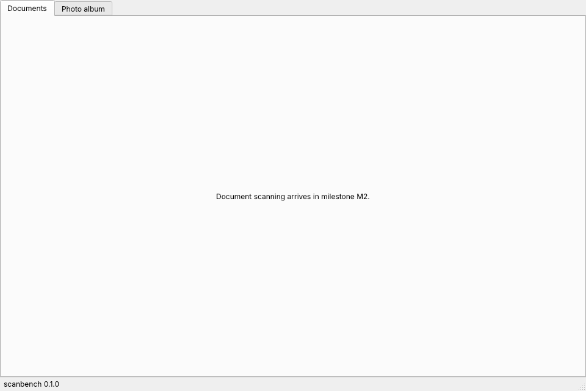

# Getting started

Back to: [User documentation](README.md) · [Documentation home](../README.md)

## Start

From the application menu, or in a terminal:

~~~bash
scanbench
~~~

The status bar shows the version. When scanbench runs from a git clone
instead of an installed release, the version text says
`source checkout <path>, not an installed release`.

## Commands

| Command | Purpose |
|---|---|
| `scanbench` or `scanbench gui` | start the graphical interface |
| `scanbench doctor` | show version, directories and external programs; exit status 1 if a required program is missing |
| `scanbench install-desktop` | add the launcher entry and icon for the current installation |
| `scanbench uninstall-desktop` | remove the launcher entry and icon |
| `scanbench update` | maintainer: release delivered patch archives and install ([updating](updating.md)) |
| `scanbench publish` | maintainer: first publication on GitHub ([updating](updating.md)) |
| `scanbench --version` | print the version |

All commands run as normal user.

## Where scanbench keeps its files

| Content | Default | With `SCANBENCH_HOME` |
|---|---|---|
| Settings, device profiles | `~/.config/scanbench` | `$SCANBENCH_HOME/config` |
| Logs | `~/.local/state/scanbench/logs` | `$SCANBENCH_HOME/logs` |
| Installed releases | `~/.local/share/scanbench/venvs/X.Y.Z`, active one linked as `venv` | `$SCANBENCH_HOME/venvs/X.Y.Z`, `$SCANBENCH_HOME/venv` |
| Applied patch archives | `~/.local/share/scanbench/releases` | `$SCANBENCH_HOME/releases` |

`scanbench doctor` prints the directories actually in use.
